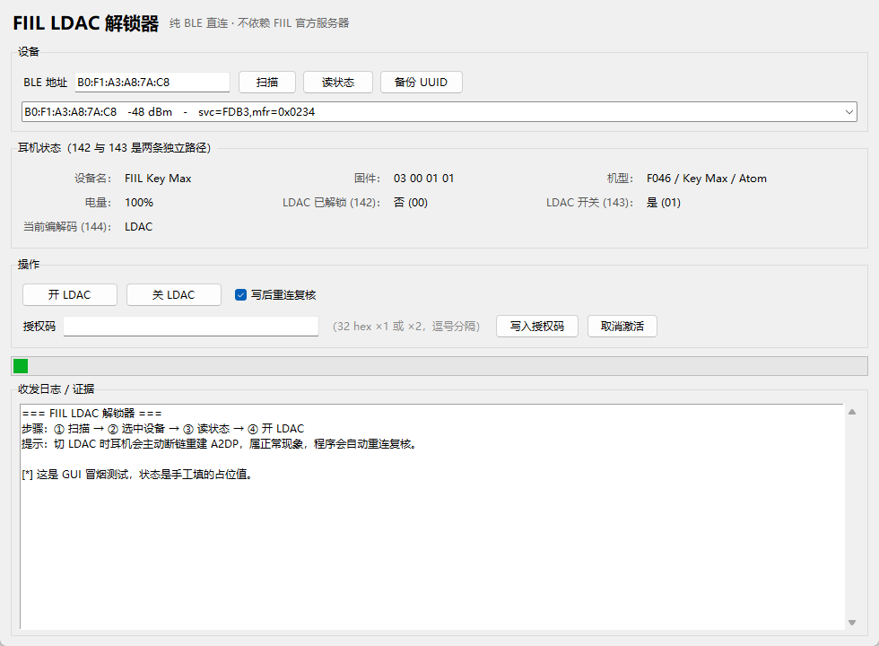

# FIIL 耳机 LDAC 离线激活工具集

> **当官方服务器已经下线，如何在自己买的耳机上重新打开 LDAC。**

[](LICENSE)
[](https://www.python.org/)
[](#平台支持)
[](docs/PROTOCOL.md)

**[简体中文](README.md)** | [English](docs/en/README.md)

---

## 这是什么

FIIL 耳机的 **LDAC 高清解码**需要先在官方 App（FIIL+）里点一次「激活」。
激活的本质是：App 从厂商服务器拿到一段 `activateCode`，通过蓝牙写进耳机，
耳机把内部的一个标志位置 1，LDAC 开关才变成可点。

**但 FIIL 的三个后端域名已经全部 NXDOMAIN 了**（详见 [服务器状态证据](#为什么说服务器已经死了)），
官方 App 里点「激活」只会转圈失败——你的耳机硬件明明支持 LDAC，却被一个已经关停的服务器锁住了。

本项目把 FIIL+ 3.5.2 的激活链路完整逆向出来，并对协议的命令空间做了**全量盲扫**，
提供 **5 种不依赖服务器的替代方案**，外加一份实测过的「什么能做、什么做不到」清单。
所有结论都标注了反编译产物的 `文件:行号`。

> 本项目**只恢复你已购买设备的既有功能**，不提供任何绕过设备安全机制的手段，
> 不包含官方 APK、反编译产物或任何受版权保护的素材。详见 [DISCLAIMER.md](DISCLAIMER.md)。

---

## 核心结论：激活链路只有一步依赖网络

```
①  点「激活」          F048HomeFragment.B(View)
        ↓
②  读左右耳 UUID       FiilManager.getUUID(TRUE, cb) / getUUID(FALSE, cb)
        ↓  拼成 deviceCode = "<左耳32hex>,<右耳32hex>"
③  HTTP 请求           GET http://newservice.fiil.com/app/headset/activation/info?deviceCode=xxx
        ↓  服务器返回 {"code":"200","data":"{\"activateCode\":\"...\"}"}
④  UnlockLDACActivity  ← 从这里开始**完全离线**
        取 Intent 里的 "activateCode"
        按逗号切两段 16 字节 hex
        左耳补 0x00、右耳补 0x01 → 各 17 字节
        按 Intent 里的 "type" 分派到四条蓝牙通道写进耳机
```

**关键：第 ④ 步不联网。** 但 1.1.0 的真机实测补上了一个更关键的事实：
**第 ④ 步写进去的 license 会被固件校验，写错内容反而会清掉已有解锁状态**（见下方 FAQ）。
所以「服务器死了」并不意味着「本地随便造个码就能替代」，这条链路真正的断点在第 ③ 步的
**服务器侧签名**，而不在第 ④ 步。

**另一条更重要的实测结论**：`142`（授权）与 `143`（开关）在 F046 上是**两条独立路径**，
LDAC 开关本身并不需要 license。详见下方 FAQ「那 LDAC 还能打开吗」。

`UnlockLDACActivity` 的四条通道（`UnlockLDACActivity.java:205-254`）：

| `type` | 通道 | 代码位置 | 机型 |
|---|---|---|---|
| `1` | F43 SDP | `com.fengeek.utils.l1.n0.setLDAC()` | F043 |
| `2` | F39 / Bluetrum | `F39AppSettingRequest.setActivateLdac()` | CC Pro2 / F039 |
| `3` | F048 SDP | `com.fengeek.main.i.d.e.setActivationLdac()` | F048 |
| 其它 | Gaia 老协议 | `FiilManager.setUnlockLDAC()` → 命令 1968 | F039/F040 等老固件 |

协议细节见 [docs/PROTOCOL.md](docs/PROTOCOL.md)。

---

## 五种方案

| # | 方案 | 需要 root | 需要重打包 | 需要 PC | 需要配对出 COM 口 | 适用机型 | 工具 |
|---|---|---|---|---|---|---|---|
| 一 | **CC Pro2 隐藏后门（长按）** | 否 | 否 | 否 | 否 | 仅 CC Pro2 / F039 | 原版 App |
| 二 | **PC 串口写码** | 否 | 否 | 是 | **是** | 全机型 | [`src/fiil_ldac.py`](src/fiil_ldac.py) |
| 三 | **本地假服务器 + 原版 App** | 视情况 | 否 | 是 | 否 | 全机型 | [`src/fake_server.py`](src/fake_server.py) |
| 四 | **重打包 APK 内嵌激活码** | 否 | 是 | 是 | 否 | 全机型 | [`src/patch_apk.py`](src/patch_apk.py) |
| 五 | **PC 端纯 BLE 直连（推荐）** | 否 | 否 | 是 | **否** | F046 / F048 等 Mate 族 | [`src/fiil_ble.py`](src/fiil_ble.py) |

按折腾程度从低到高：**五 → 一 → 三 → 二 → 四**。

### 方案五：PC 端纯 BLE 直连（1.1.0 新增，真机验证）

方案二是唯一一条「纯 PC 侧、不碰手机」的路子，但它卡在一个前提上：
**要用 SPP/RFCOMM 就得在 Windows 里配出串口**，而很多机器（尤其是蓝牙 4.2 的老适配器）
根本配不出稳定的 COM 口——本项目的测试机就是这种情形（COM3 能打开，握手却没有任何回包）。

方案五绕开 SPP，直接走 **BLE GATT**——同一副耳机在 BLE 侧就有服务：

| 项 | UUID / 值 |
|---|---|
| 服务 | `0000fdb3-0000-1000-8000-00805f9b34fb` |
| 写特征 | `0000ff17-0000-1000-8000-00805f9b34fb` |
| 通知特征 | `0000ff18-0000-1000-8000-00805f9b34fb` |
| CCCD | `00002902-0000-1000-8000-00805f9b34fb` |

帧格式与 SPP 侧的 `writeMate` **完全一致**（`com.fengeek.main.i.b.writeMate`），
所以 BLE 与 SPP 共用同一套字节布局：

```
[seq][cid][0x01][0x00] + ([(plen+2), cmdId] if cmdId!=0) + [plen] + payload
```

```bash
pip install bleak

# 1. 扫描，按 服务UUID + 厂商ID 0x0234 认出 FIIL 设备
python src/fiil_ble.py scan

# 2. 读全部状态（型号 / 固件 / UUID / 142 / 143 / 144）
python src/fiil_ble.py status --addr B0:F1:A3:A8:7A:C8

# 3. 备份当前 license
python src/fiil_ble.py backup --addr B0:F1:A3:A8:7A:C8

# 4. 开 / 关 LDAC（真机验证可用；切 LDAC 会重建 A2DP，断链属预期）
python src/fiil_ble.py switch --on  --addr B0:F1:A3:A8:7A:C8
python src/fiil_ble.py switch --off --addr B0:F1:A3:A8:7A:C8

# 5. 写 license（只在你有有效码时用；离线伪造已被证伪）
python src/fiil_ble.py unlock --from-device-uuid --dry-run    # 先看会发什么，不发送
python src/fiil_ble.py unlock --code <32位hex> --yes           # 用你自己拿到的有效码
```

**实测记录**（FIIL Key Max，`B0:F1:A3:A8:7A:C8`，固件 3.0.1.1）：

| 命令 | 结果 |
|---|---|
| `scan` | 命中 `rssi=-48 svc=FDB3 mfr=0x0234 ← FIIL` |
| `status` | `FIIL Key Max` / PID `00 2E 01`（F046）/ 左右 UUID 相同 / 142=01 / 143=01 / 144=02 |
| `switch --off` | ACK 后重连复核 143=`00` ✓ |
| `switch --on` | 先 `setLowDelay(0)`，再 `setLdacSwitch(1)` → 断链 → 重连复核 143=`01`、144=`02` ✓ |

**官方开关顺序**（`F046HomeFragment.java:395-405`，程序已按此实现）：
开 LDAC 前**必须先关低延迟**，否则固件会拒绝——这一步很多第三方实现都漏了。

原始收发帧全部落在 `docs/evidence/ble_*.log`，可逐帧核对。

#### 图形界面（1.3.0 新增）

不想敲命令的话，同一套功能有桌面界面：

```bash
python src/fiil_gui.py
```

界面分三块——设备（扫描 / 读状态 / 备份 UUID）、状态（型号 / 固件 / 电量 /
`142` / `143` / `144`）、操作（开 LDAC / 关 LDAC / 写授权码 / 取消激活），
下面的日志框逐行显示每一帧 TX/RX，同时照常写 `docs/evidence/`。
写授权码和取消激活都会先弹确认框。

也可以打包成 exe：

```bash
python tools/build_exe.py           # 默认 --onedir，推荐
# 产物：dist/FiilLdacUnlock/FiilLdacUnlock.exe
```

> ⚠️ **别用 `--onefile`**。单文件模式启动时要把自己解包到 `%TEMP%\_MEIxxxxx`，
> 在受限令牌 / 沙箱环境里会报 `Could not create temporary directory!` 然后退出
> （本项目实测踩到过）。`--onedir` 不需要解包，可正常启动，代价是
> `_internal/` 目录必须和 exe 放在一起。

界面在 980×720 下的实际显示：



### 方案一：CC Pro2 长按后门（30 秒，仅 F039）

App 里留了一个**连服务器都不问**的调试后门（`CcPro2NewEleFragment.java:609-650`）：

```java
if (com.fengeek.utils.j.f32868a) {          // f32868a = BuildConfig.DEBUG，发布包里是 true
    this.W3.setOnLongClickListener(...);    // W3 = 电量数字控件
}
// g0(): 直接下发两次 setActivateLdac，内容是全零 license，不联网
```

**操作**：原版 App 连上 CC Pro2 → 进电量页 → **长按电量数字** → 等指示灯闪一下 → 看 LDAC 开关是否可点。

### 方案二：PC 串口写码

FIIL 的私有通道是 **SPP / RFCOMM**（UUID `d52b47bc-2dea-42c4-b26d-20252fceeeb3`），
不是 BLE GATT。Windows 配对后会自动映射成虚拟 COM 口，`pyserial` 直接读写即可。

```bash
pip install pyserial

# 1. 耳机与 PC 配对，设备管理器里找到新增的 COM 口
python src/fiil_ldac.py list

# 2. 只看帧，不连接（先确认机型对得上）
python src/fiil_ldac.py frames --proto f39      # 也可 --proto gaia / f43 / f048

# 3. 备份当前 license（重要，写坏了还能恢复）
python src/fiil_ldac.py backup --port COM5

# 4. 写码（--zeros = 全零 license，等效方案一的后门）
python src/fiil_ldac.py activate --port COM5 --zeros --proto f39

# 5. 打开 LDAC
python src/fiil_ldac.py switch --port COM5 --on --proto f39

# 6. 验证
python src/fiil_ldac.py read --port COM5
```

`--proto` 取值（**四套帧**，详见 [docs/PROTOCOL.md §13](docs/PROTOCOL.md) 的对照表）：

| 取值 | 对应机型 | 帧头 | 长度字段含义 |
|---|---|---|---|
| `f39` | CC Pro2 / F039（Bluetrum 分片） | 5 字节 | 仅本片 payload |
| `f43` | F043（SDP） | 8 字节 | 含 `cmdId`（`+2`） |
| `f048` | F048（SDP） | 8 字节 | 含 `cmdId`（`+2`） |
| `gaia` | F039–F043 老机型（`com.fiil.sdk`） | 8 字节 | **仅 payload** |

⚠️ `gaia` 是 1.4.0 新加的，**只做过组帧层面的验证**（与反编译源码逐字节一致），
没有 F039–F043 系列耳机可上机测试。
`f048` 的 LDAC 开关已定位（`e.java:573-588`，cid=1 / cmdId=13，与 F046 逐字节相同，
只是走 SDP 而非 Mate），同样**未真机验证**。

### 方案三：本地假服务器

在局域网起一个 HTTP 服务冒充 `newservice.fiil.com`，让原版 App 以为服务器还活着，
从而走完「激活按钮 → 拿 activateCode → 写进耳机」的原始链路。

```bash
# PC 上起服务
python src/fake_server.py --host 0.0.0.0 --port 8080

# 模式
#   --mode zero     全零 license（默认，等效方案一）
#   --mode random   随机 16 字节
#   --mode echo     把 deviceCode 原样回填（最像真服务器）
#   --code "AA..,BB.."  固定激活码
```

> ⚠️ 1.1.0 修正：固件**会校验** license。`zero` / `random` 只能用来验证协议链路走不走得通，
> **不可能**因此真的解锁。要解就用 `--code` 喂一段你合法取得的激活码。

然后二选一：

- **改 hosts**（需 root / Magisk）：`<PC局域网IP>  newservice.fiil.com`
- **走 HTTP 代理**（无需 root）：手机 Wi-Fi → 代理 → `<PC局域网IP>:8080`
  （App 只发 http，不加密，不用装证书）

优点：不用卸载 App，登录态和绑定数据全保住。

### 方案四：重打包 APK

把 `F048HomeFragment.o()` 的方法体换成直接 `startActivity(UnlockLDACActivity)` 并带上写死的码，
跳过网络请求。脚本自动找注入点、把 `.locals` 提到 100、注入 smali、回编译、签名。

```bash
# 前置：原版 APK 放 <仓库根>/fiil.apk，apktool.jar 放 <仓库根>/tools/
# JDK 11+ 与 Android SDK build-tools（zipalign / apksigner）

python src/patch_apk.py decompile
python src/patch_apk.py inject                 # 默认全零，或 --code "左32hex,右32hex"
python src/patch_apk.py build

adb uninstall com.fengeek.f002
adb install -r build/fiil_patched.apk
```

⚠️ 重打包后签名变了，**必须先卸载原版**，登录态/绑定数据会丢失。

---

## 安装

```bash
git clone https://github.com/FNKG9527/fiil-ldac-unlock.git
cd fiil-ldac-unlock
pip install -r requirements.txt
```

`requirements.txt` 有两项：`pyserial>=3.5`（方案二）与 `bleak>=0.22`（方案五）。
方案一、三、四只用 Python 标准库。

### 平台支持

| 平台 | 方案二（串口） | 方案三（假服务器） | 方案四（重打包） | 方案五（BLE） | 图形界面 |
|---|---|---|---|---|---|
| Windows | ✅ 配对后自动生成 COM 口 | ✅ | ✅ | ✅ 需 Win10 1809+ | ✅ |
| Linux | ⚠️ 需 `rfcomm bind` 或蓝牙 SPP 工具 | ✅ | ✅ | ✅ BlueZ ≥ 5.43 | ✅ 需 `python3-tk` |
| macOS | ⚠️ 需 `socat` 桥接 `/dev/tty.*` | ✅ | ✅ | ✅ macOS 11+ | ✅ |

### 自检

不需要耳机、不需要串口，验证组帧字节是否与逆向结果一致：

```bash
python src/selftest.py
# 结果：73 通过，0 失败（有反编译产物时）
# 结果：52 通过，0 失败（无反编译产物时，后 21 项 SKIP）
```

---

## 仓库结构

```
fiil-ldac-unlock/
├── src/
│   ├── fiil_gui.py         # 图形界面（tkinter）：扫描 / 读状态 / 开 LDAC / 写授权码
│   ├── fiil_ble.py         # 方案五：PC 端纯 BLE 直连（bleak，无需 COM 口）
│   ├── fiil_ldac.py        # 方案二：串口直写（Mate / SDP / F39 / Gaia 四套帧）
│   ├── fake_server.py      # 方案三：本地假服务器
│   ├── patch_apk.py        # 方案四：APK 重打包注入
│   ├── probe_guard.py      # 盲扫护栏：拦住 cid=36 恢复出厂等危险命令
│   └── selftest.py         # 离线自检
├── tools/
│   └── build_exe.py        # 把 GUI 打包成 Windows exe（默认 --onedir）
├── docs/
│   ├── PROTOCOL.md         # 四套帧格式 + BLE 通道的完整规格
│   ├── ACTIVATION_FLOW.md  # 激活链路逐步拆解（含文件行号）
│   ├── TROUBLESHOOTING.md  # 常见问题
│   ├── evidence/           # 真机收发帧日志
│   └── en/                 # English translation
├── examples/
│   ├── dump_frames.py      # 打印各协议帧，不连接设备
│   └── probe_headset.py    # 只读探测：读激活状态与 UUID
├── backup/                 # backup 子命令产出的 license 快照（已 gitignore）
├── .github/workflows/ci.yml
├── LICENSE                 # GPL-3.0
├── NOTICE                  # 商标与归属声明
├── DISCLAIMER.md           # 使用边界与合规声明
├── CONTRIBUTING.md
├── SECURITY.md
├── CHANGELOG.md
└── README.md
```

---

## 常见问题

**Q：我的耳机型号不在表里怎么办？**
先用 `python src/fiil_ldac.py frames --proto f39` 之类**只看帧不连接**，对照 [docs/PROTOCOL.md](docs/PROTOCOL.md)
判断机型走哪套协议；拿不准就先跑 `examples/probe_headset.py` 只读探测。

**Q：写全零 license 会不会把耳机写坏？**

会。**这是本项目 1.1.0 修正的最重要一条结论。**

早期版本根据「`CcPro2NewEleFragment` 后门发全零 license」推断「固件不校验内容」，
这个推断**是错的**，已被真机实测推翻：

| 写入内容 | 耳机 ACK | 读回 142 |
|---|---|---|
| `00 ‖ 设备UUID16B` | `00`（成功） | **`00`（解锁状态被清掉）** |
| `17 字节全零` | `00`（成功） | `00` |
| 15 种校验和变体 | `00`（成功） | `00` |
| 43 种 md5/sha1 派生 | `00`（成功） | `00` |

结论有三条：

1. **ACK 只表示「命令格式合法」，不表示「license 被接受」**——两者必须分开判断。
   1.2.0 逐长度盲扫后把这条说得更准了：`setActivationLdac` 的 ACK **只校验「长度恰好 17」+「首字节 ∈ {0,1}」**，
   后 16 字节内容完全不参与校验。判断 license 是否被接受的唯一依据是回读 `142`（`getLdacUnlockStatus`）。
2. 固件**确实校验** license 内容，写错内容会把已有的解锁状态**清掉**，且不会自动恢复。
3. `activateCode` **不是设备 UUID 的简单派生**，也不是纯校验和，几乎必然含服务器侧私有盐/密钥。
   在官方服务器下线（`newservice.fiil.com` NXDOMAIN）的今天，**离线伪造 license 已被证伪**。

另有一条 1.2.0 的否定结论值得记下：把 `cid=39` 的 255 条查询命令全扫了一遍，
**没有任何一条能回读已写入的 license**。也就是说既不能伪造、也不能从另一台已授权的耳机上把码拷过来。

因此：**动手前一定先 `backup`**，且不要指望「随便造一串码写进去」能解锁。

**Q：那 LDAC 还能打开吗？**

能——但路径和官方 UI 暗示的不一样。

真机实测（FIIL Key Max / F046，固件 3.0.1.1）证明 **`142`（授权）与 `143`（开关）是两条独立路径**：

| 142 授权 | 143 开关 | 144 编解码 | LDAC 实际生效 |
|---|---|---|---|
| `00` | `01` | `02` | **是** |

即 **LDAC 开关本身不需要 license**，license 只影响官方 App 的 UI 是否放行那个开关。
所以本项目现在把「**开/关 LDAC**」作为主功能（真机验证可用），
把「写 license」保留为「写入你在别处已取得的有效码」的通道（离线伪造已证伪）。

**Q：固件升级后 LDAC 又没了？**
正常，升级会清掉激活标志。重新跑一次对应方案即可。

**Q：盲扫 / 试命令时有没有不能碰的命令？**

有，一条会**恢复出厂设置**。

`cid=36` 的 `setReset` 在源码里是这样写的（`com/fengeek/main/i/d/c.java:489-502`）：
它**只设置 `commandClassifyId(36)`，既不带 `commandId` 也不带 payload**。
换句话说，任何 `cid=36` 的 5 字节空帧都是一次恢复出厂——我在盲扫 cid 时就因此把测试耳机打掉了
（当场断开、停止 BLE 广播，需要手动重新开机）。

所以任何扫描脚本都必须跳过 `cid=36`。本项目把它固化成了 [`src/probe_guard.py`](src/probe_guard.py)：

```python
from probe_guard import is_safe_cid, assert_safe

if not is_safe_cid(cid):
    continue          # 跳过 cid=36 与 12 个会改状态的命令族
assert_safe(cid, cmd)  # 不安全直接抛 UnsafeCommandError
```

顺带记下另一个发现：`cid=35` 是固件已实现、但 FIIL+ 源码里**没有任何调用点**的第 5 个命令族。
它回了 ACK，但具体语义未展开（风险高于收益，没继续扫）。

**Q：会不会被判定为盗版？**
不。LDAC 解码能力是耳机硬件本身支持的，激活只是厂商的软件锁；
本项目恢复的是你已购买设备上的既有功能。详见 [DISCLAIMER.md](DISCLAIMER.md)。

更多见 [docs/TROUBLESHOOTING.md](docs/TROUBLESHOOTING.md)。

---

## 为什么说服务器已经死了

```powershell
PS> Resolve-DnsName newservice.fiil.com
Resolve-DnsName : newservice.fiil.com : DNS name does not exist

PS> Resolve-DnsName sapp.fengeek.com
Resolve-DnsName : sapp.fengeek.com : DNS name does not exist

PS> Resolve-DnsName ms.fiil.com
Resolve-DnsName : ms.fiil.com : DNS name does not exist
```

三个后端域名全部 NXDOMAIN。App 里所有联网功能（激活、OTA、商城、语音）都已失效，
**但蓝牙本地功能（EQ、降噪、LDAC 开关）仍然可用**——因为那部分走 SPP，不经过网络。

---

## 贡献

欢迎提交**带证据的**勘误与新机型实测数据。硬性规则：**没有来源的结论不合并。**

来源只有两种：反编译产物的 `文件:行号`，或 `docs/evidence/` 下的原始日志（需含完整 TX/RX 字节）。
详见 [CONTRIBUTING.md](CONTRIBUTING.md)。

## 安全

发现安全问题请**不要开公开 issue**，按 [SECURITY.md](SECURITY.md) 的流程私下报告。

## 许可

代码以 **GNU General Public License v3.0** 发布，见 [LICENSE](LICENSE)。
文档（`docs/`、`README.md`）以 **CC BY-SA 4.0** 发布。

商标归属见 [NOTICE](NOTICE)。使用边界见 [DISCLAIMER.md](DISCLAIMER.md)。

## 致谢

- [jadx](https://github.com/skylot/jadx) — 反编译
- [apktool](https://apktool.org/) — 资源与 smali 处理
- [pyserial](https://github.com/pyserial/pyserial) — 串口通信
